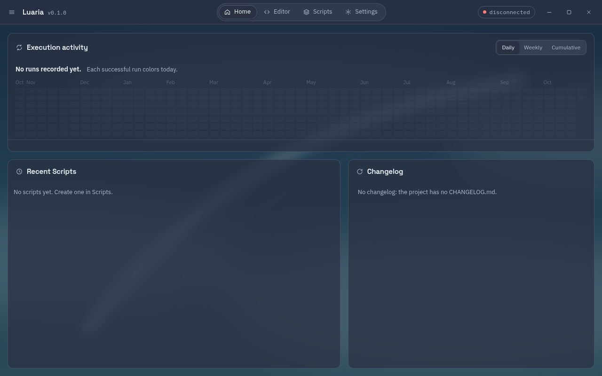
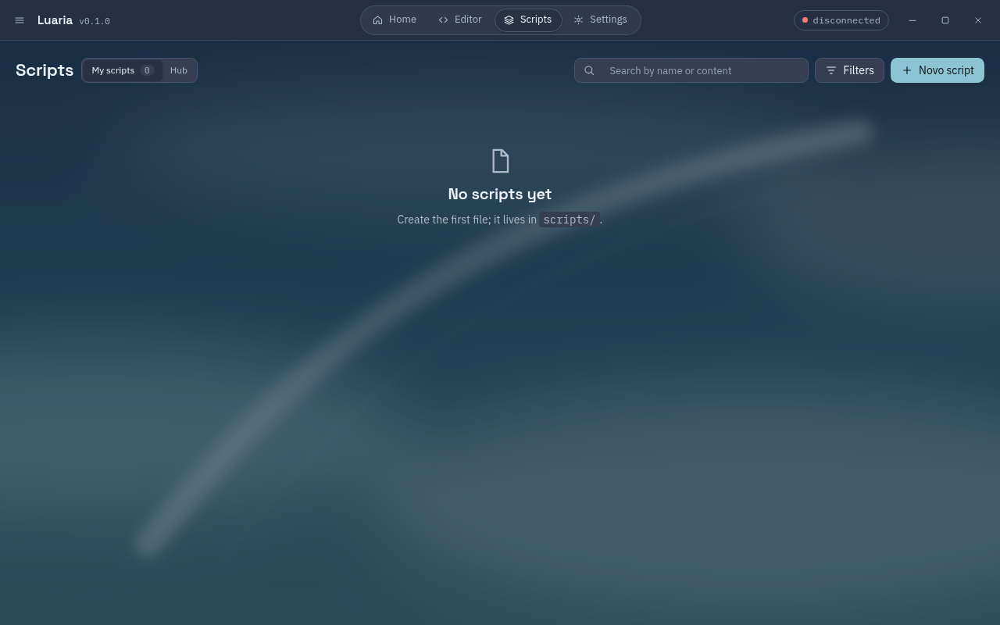
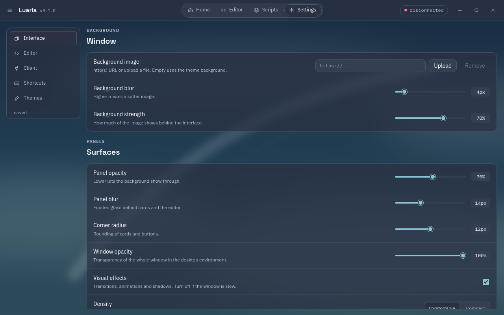

<h1 align="center">Luaria</h1>

<p align="center">
  Luau script executor for the Roblox Android x86_64 client running in Mocktail on Linux.<br>
  No root, no DLL, no modified client.
</p>

<p align="center">
  <a href="https://github.com/VitzS7/luaria/actions/workflows/ci.yml"></a>
  <a href="LICENSE"></a>
  <a href="https://github.com/VitzS7/luaria/releases"></a>
  
  
</p>

<p align="center">
  <a href="README.pt-BR.md">Português (pt-BR)</a> ·
  <a href="docs/architecture.md">Architecture</a> ·
  <a href="docs/limitations.md">Limitations</a> ·
  <a href="CONTRIBUTING.md">Contributing</a>
</p>

<p align="center">
  
</p>

> Read the [legal notice](docs/legal-notice.md) before using or contributing.

## Preview

| Home | Scripts |
| --- | --- |
|  |  |
| **Settings and themes** | **Editor** |
|  |  |

## What is this

Luaria runs Luau scripts inside the Roblox Android x86_64 client, running in Mocktail on Linux. It injects through `ptrace` into the already-open process: no root, no DLL, no modified client. The engine compiles the script with the same Luau release as the client's VM, translates the bytecode to the opcodes of this build, and calls the client's real `luau_load` and `luaD_call`.

The project ships a webview UI (served over a local HTTP server on `127.0.0.1`), a GTK4 fallback UI, and a command-line tool.

## Status

- **UNC: 58/83** on the last live measurement (25 failures). We do not promise 100%.
- **sUNC:** an own test suite written from the public contract lives in `scripts/sunc_own.lua` (79 tests); its score is not published yet.
- `debug.setconstant` and `debug.setupvalue` are implemented as natives with a GC write barrier, but are still **experimental**: validated offline only, not yet on a live client.
- Functions that need native code not yet written (`hookfunction`, `getconnections`, `getproto`, etc.) are listed in [docs/limitations.md](docs/limitations.md).
- The engine only works with the client build it was validated against. When Roblox updates the client, the engine refuses to run instead of executing wrong code until it is measured again.

## Requirements

| Item | How to get it |
| --- | --- |
| Client open | Mocktail with an experience open (not the menu). `tools/launch.sh <PlaceId>` opens it and waits |
| `luau-compile` from Luau release 735 | `tools/luau.sh` clones and builds it into `~/.cache/luaria/` |
| GTK4 and WebKitGTK 6.0 (build only) | A local sysroot (or set `GTK4_SYSROOT`); nothing is installed system-wide |
| Rust stable | `rustup` |

The engine waits for a real `luaD_call` to hook into. If the client is in the menu, execution waits up to 20 s and tries again.

## Build and install

```bash
tools/build.sh                    # luaria (webview UI) + luaria-gtk + luaria-cli
tools/build.sh --bin luaria-cli   # a single binary
tools/instalar.sh                 # installs to ~/.local (bin, icon, .desktop), no root needed
```

Binaries go to `~/.cache/luaria-target/release/` (or `CARGO_TARGET_DIR`). `tools/instalar.sh` puts `luaria` and `luaria-cli` in `~/.local/bin`, plus the `dev.luaria.executor.desktop` launcher and the icon in the hicolor theme.

Unit tests (no client needed):

```bash
cargo test -p luaria --lib
cargo test -p luaria --bin luaria
```

Prelude test outside the game, with the Luau REPL (see [docs/contributing-a-function.md](docs/contributing-a-function.md)).

## Usage

**UI** (`luaria`): a window that serves the UI at `127.0.0.1:<port>`. Editor (CodeMirror 6, tabs, `Ctrl+S`, `Ctrl+F`), file tree, console with script output and a problems tab, Scripts (search, rename, delete), Settings (themes, colors, background, font). The UI reconnects on its own when the client closes and comes back.

**CLI** (`luaria-cli`):

```bash
luaria-cli exec script.lua              # run on the open client
luaria-cli exec script.lua --pid=N      # a specific client
luaria-cli exec script.lua --ficar      # keep serving the host-to-game channel
luaria-cli opcodes                      # opcode map of this build
luaria-cli chunk script.lua --mapa=mapa.txt
```

The other subcommands (`resolve`, `fn`, `xrefs`, `strings`...) are binary analysis tools used during development.

Quick check, with the client inside an experience:

```bash
tools/test_exec.sh scripts/teste_print.lua LUARIA_OK_1
```

## Features

A summary of what is implemented (the exact list is in `assets/prelude.lua`; what is pending is in `docs/limitations.md`):

- Base: `loadstring` (literal inlined; dynamic strings go through the Luau interpreter), `getgenv` wired to the script's globals, `identifyexecutor`, `setclipboard`, `request`/`http_request` through the host-to-game channel.
- Files: `writefile`, `readfile`, `isfile`, `isfolder`, `makefolder`, `delfile`, `delfolder`, `listfiles`, `appendfile` (stored in `~/.config/luaria/Workspace/`).
- Crypt (hashes, AES in non-GCM modes, base64), `lz4compress`/`lz4decompress`.
- Metatables: `getrawmetatable`, `setrawmetatable`, `setreadonly` (through natives in the stub).
- Introspection: `debug.getinfo`, `debug.getconstant(s)`, `debug.getupvalue(s)`, `getgc`, `getinstances`, `getnilinstances`.
- Approximate (partial behavior, documented in `docs/limitations.md`): `Drawing`, `getsenv`, `getrunningscripts`, `getloadedmodules`, `newcclosure`, `cloneref`, `checkcaller`.

Environment variables for diagnostics and tuning: [docs/environment-variables.md](docs/environment-variables.md).

## How it works

Overview in [docs/architecture.md](docs/architecture.md): Luau compilation, opcode translation, ptrace injection, stub and natives, host-to-game bridge, UI and local server.

## Limitations

See [docs/limitations.md](docs/limitations.md). The main ones: long scripts freeze the whole game (there is no safe way to abort in the middle), script errors propagate without a C-side `pcall` by default, and the engine only works with the measured payload (when Roblox updates the binary, the engine refuses instead of running garbage).

## Testing

```bash
cargo test -p luaria --lib
cargo test -p luaria --bin luaria
sed -e '/^--@@PRELUDE@@/r assets/prelude.lua' -e '/^--@@PRELUDE@@/r assets/loadstring.lua' \
    scripts/teste_prelude.lua > /tmp/p.lua && luau /tmp/p.lua
```

The last test prints `OK n/n`. Integration tests (`tools/test_exec.sh`, `tools/unc.sh`) need the live client and are manual; they do not run in CI.

## UI development

`LUARIA_DEV=1 luaria` reads `assets/ui/` from disk (run it from the repository root), so CSS and JS changes apply without recompiling. The CodeMirror bundle (`assets/ui/app.js`) is committed; regenerate it with:

```bash
cd assets/ui && npm ci && npm run build
```

## Repository map

| Path | What it is |
| --- | --- |
| `crates/luaria/src/engine.rs` | engine: connection, loading, patching, remote calls |
| `crates/luaria/src/opcodes.rs` | Luau dump reading and opcode translation |
| `crates/luaria/src/hook.rs`, `nativas.rs` | x86-64 stub and client natives |
| `crates/luaria/src/ponte*.rs` | host-game channel (shared-memory ring) |
| `crates/luaria/src/prelude.rs`, `assets/prelude.lua` | executor API |
| `crates/luaria/src/bin/ui_web.rs`, `bin/ui_web/` | webview UI, local server, state and API |
| `crates/luaria/src/bin/ui.rs` | pure GTK4 UI (`luaria-gtk` binary, fallback) |
| `crates/luaria/src/bin/cli.rs` | `luaria-cli` |
| `assets/ui/` | UI HTML, CSS and JS |
| `scripts/` | Lua test scripts and the UNC test |
| `tools/` | build, installation, integration tests |
| `docs/` | architecture, environment variables, limitations, how to contribute |

## Contributing

Read [CONTRIBUTING.md](CONTRIBUTING.md) first. Contributions must follow the [Code of Conduct](CODE_OF_CONDUCT.md). Found a vulnerability? Do not open a public issue; see [SECURITY.md](SECURITY.md).

## License and third-party code

Code is licensed under [MIT](LICENSE). Third-party libraries and their license texts are listed in [THIRD_PARTY_NOTICES.md](THIRD_PARTY_NOTICES.md).

## Releases and binaries

We do not distribute precompiled binaries. Official releases are published only in this repository. If you find an executable "of Luaria" on another site, fork or release, be suspicious: it is not ours.

## Disclaimer

Research and education project. Not affiliated with Roblox Corporation, Mocktail, or any other project cited here. Roblox is a registered trademark of Roblox Corporation. Using this violates the Roblox Terms of Use and can get your account banned. Use it at your own risk, on throwaway accounts. We do not accept anti-cheat bypasses or malicious scripts. Details in [docs/legal-notice.md](docs/legal-notice.md).
