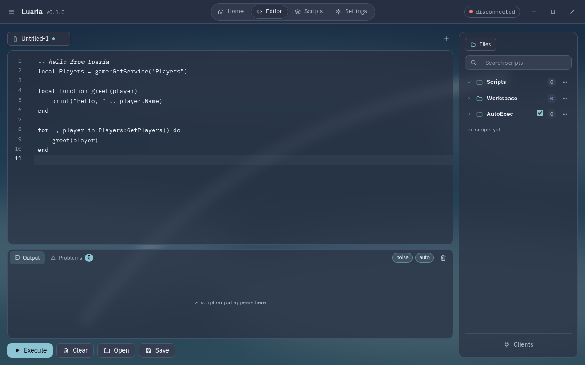

<h1 align="center">Luaria</h1>

<p align="center">
  Executor de scripts Luau para o cliente Roblox Android x86_64 rodando no Mocktail, no Linux.<br>
  Sem root, sem DLL, sem cliente modificado.
</p>

<p align="center">
  <a href="https://github.com/VitzS7/luaria/actions/workflows/ci.yml"></a>
  <a href="LICENSE"></a>
  <a href="https://github.com/VitzS7/luaria/releases"></a>
  
</p>

<p align="center">
  <a href="README.md">English</a> ·
  <a href="docs/pt-BR/architecture.md">Arquitetura</a> ·
  <a href="docs/pt-BR/limitations.md">Limitações</a> ·
  <a href="CONTRIBUTING.pt-BR.md">Contribuindo</a>
</p>

<p align="center">
  
</p>

## O que é

Executa Luau dentro do cliente Roblox Android x86_64 rodando no Mocktail no Linux. O script entra pela memória do processo que já está aberto: sem root, sem DLL, sem cliente modificado. O motor compila o script com o mesmo Luau da VM do cliente, traduz o bytecode para os opcodes deste build e chama o `luau_load` e o `luaD_call` reais do cliente.

## Status

- **UNC: 58/83** na última medição (25 falhas). Não prometemos 100%.
- **sUNC:** não medido publicamente.
- `debug.setconstant` e `debug.setupvalue` existem como nativas com barreira do GC, mas ainda são **experimentais**: validadas só offline, ainda não em cliente real.
- Funções que dependem de código nativo ainda não existente (`hookfunction`, `getconnections`, `getproto`, etc.) estão listadas em [docs/pt-BR/limitations.md](docs/pt-BR/limitations.md).

## Requisitos

| Item | Como conseguir |
| --- | --- |
| Cliente aberto | Mocktail com a experiência aberta (não no menu). `tools/launch.sh <PlaceId>` abre e espera |
| `luau-compile` da release 735 | `tools/luau.sh` clona e compila em `~/.cache/luaria/` |
| GTK4 e WebKitGTK 6.0 (só para o build) | sysroot local em `~/tools/gtk4-sysroot` (ou `GTK4_SYSROOT`); nada é instalado no sistema |
| Rust stable | `rustup` |

O motor espera uma chamada real de `luaD_call` para pendurar a execução. Se o cliente estiver no menu, a execução espera até 20 s e tenta de novo.

## Compilar e instalar

```bash
tools/build.sh                    # luaria (UI webview) + luaria-gtk + luaria-cli
tools/build.sh --bin luaria-cli   # só um binário
tools/instalar.sh                 # instala em ~/.local (bin, ícone, .desktop), sem root
```

Binários em `~/.cache/luaria-target/release/` (ou `CARGO_TARGET_DIR`). `tools/instalar.sh` põe `luaria` e `luaria-cli` em `~/.local/bin`, o atalho `dev.luaria.executor.desktop` e o ícone no tema hicolor.

Testes unitários (não precisam de cliente):

```bash
cargo test -p luaria --lib
cargo test -p luaria --bin luaria
```

Teste do prelude fora do jogo, com o REPL do Luau (ver [docs/pt-BR/contributing-a-function.md](docs/pt-BR/contributing-a-function.md)).

## Usar

**UI** (`luaria`): janela com a UI em `127.0.0.1:<porta>`. Editor (CodeMirror 6, abas, `Ctrl+S`, `Ctrl+F`), árvore de arquivos, console com a saída do script e aba de problemas, Scripts (busca, renomear, excluir), Settings (temas, cores, fundo, fonte). A UI reconecta sozinha quando o cliente fecha e volta.

**CLI** (`luaria-cli`):

```bash
luaria-cli exec script.lua              # executa no cliente aberto
luaria-cli exec script.lua --pid=N      # cliente específico
luaria-cli exec script.lua --ficar      # mantém o atendimento do canal host→jogo
luaria-cli opcodes                      # mapa de opcodes deste build
luaria-cli chunk script.lua --mapa=mapa.txt
```

Os demais subcomandos (`resolve`, `fn`, `xrefs`, `strings`...) são ferramentas de análise do binário usadas no desenvolvimento.

Diagnóstico rápido, com o cliente dentro de uma experiência:

```bash
tools/test_exec.sh scripts/teste_print.lua LUARIA_OK_1
```

## Funcionalidades

Resumo do que está feito (a lista exata está em `assets/prelude.lua`; o pendente está em `docs/pt-BR/limitations.md`):

- Base: `loadstring` (literal inlinado; dinâmico pelo interpretador em Luau), `getgenv` ligado aos globais do script, `identifyexecutor`, `setclipboard`, `request`/`http_request` pelo canal host→jogo.
- Arquivos: `writefile`, `readfile`, `isfile`, `isfolder`, `makefolder`, `delfile`, `delfolder`, `listfiles`, `appendfile` (ficam em `~/.config/luaria/Workspace/`).
- Crypt (hash, AES em modos sem GCM, base64), `lz4compress`/`lz4decompress`.
- Metatables: `getrawmetatable`, `setrawmetatable`, `setreadonly` (via nativas no stub).
- Introspecção: `debug.getinfo`, `debug.getconstant(s)`, `debug.getupvalue(s)`, `getgc`, `getinstances`, `getnilinstances`.
- Aproximadas (comportamento parcial, documentado em `docs/pt-BR/limitations.md`): `Drawing`, `getsenv`, `getrunningscripts`, `getloadedmodules`, `newcclosure`, `cloneref`, `checkcaller`.

Variáveis de ambiente para diagnóstico e ajuste: [docs/pt-BR/environment-variables.md](docs/pt-BR/environment-variables.md).

## Como funciona

Resumo em [docs/pt-BR/architecture.md](docs/pt-BR/architecture.md): compilação Luau, tradução de opcodes, injeção por ptrace, stub e nativas, ponte host→jogo, UI e servidor local.

## Limites

Veja [docs/pt-BR/limitations.md](docs/pt-BR/limitations.md). Os principais: scripts longos seguram o jogo inteiro (não há como abortar no meio com segurança), erro de script sobe sem `pcall` do lado C por padrão, e o motor só funciona com o payload medido (a Roblox atualizando o binário, o motor recusa em vez de executar lixo).

## Testes

```bash
cargo test -p luaria --lib
cargo test -p luaria --bin luaria
sed -e '/^--@@PRELUDE@@/r assets/prelude.lua' -e '/^--@@PRELUDE@@/r assets/loadstring.lua' \
    scripts/teste_prelude.lua > /tmp/p.lua && luau /tmp/p.lua
```

O último teste imprime `OK n/n`. Os testes de integração (`tools/test_exec.sh`, `tools/unc.sh`) precisam do cliente vivo.

## Desenvolvimento da UI

`LUARIA_DEV=1 luaria` lê `assets/ui/` do disco (rodando a partir da raiz do repositório), então o CSS e o JS mudam sem recompilar. O bundle do CodeMirror (`assets/ui/app.js`) é versionado; regere com:

```bash
cd assets/ui && npm ci && npm run build
```

## Mapa do repositório

| Caminho | O que é |
| --- | --- |
| `crates/luaria/src/engine.rs` | motor: conexão, carga, patch e chamada remota |
| `crates/luaria/src/opcodes.rs` | leitura do dump Luau e tradução de opcodes |
| `crates/luaria/src/hook.rs`, `nativas.rs` | stub x86-64 e nativas do jogo |
| `crates/luaria/src/ponte*.rs` | canal host↔jogo (anel de memória compartilhada) |
| `crates/luaria/src/prelude.rs`, `assets/prelude.lua` | API do executor |
| `crates/luaria/src/bin/ui_web.rs`, `bin/ui_web/` | UI webview, servidor local, estado e API |
| `crates/luaria/src/bin/ui.rs` | UI GTK4 pura (binário `luaria-gtk`, fallback) |
| `crates/luaria/src/bin/cli.rs` | `luaria-cli` |
| `assets/ui/` | HTML, CSS e JS da UI |
| `scripts/` | scripts de teste e o teste da UNC |
| `tools/` | build, instalação, teste de integração |
| `docs/` | arquitetura, variáveis, limitações, como contribuir |

## Licença e terceiros

Código sob [MIT](LICENSE). Bibliotecas de terceiros e seus textos de licença em [THIRD_PARTY_NOTICES.md](THIRD_PARTY_NOTICES.md).

## Releases e binários

Não distribuímos binários pré-compilados. Releases oficiais só saem deste repositório. Se você encontrar um executável "do Luaria" em outro site, fork ou release, desconfie: não é nosso.

## Aviso legal

Projeto de pesquisa e educação. Sem afiliação com a Roblox Corporation, com o Mocktail ou com qualquer outro projeto citado. Roblox é marca registrada da Roblox Corporation. Usar isto viola os Termos de Uso da Roblox e pode causar banimento de conta; use por sua conta e risco, em contas descartáveis. Não aceitamos bypass de anti-cheat nem scripts maliciosos. Detalhes em [docs/pt-BR/legal-notice.md](docs/pt-BR/legal-notice.md).
